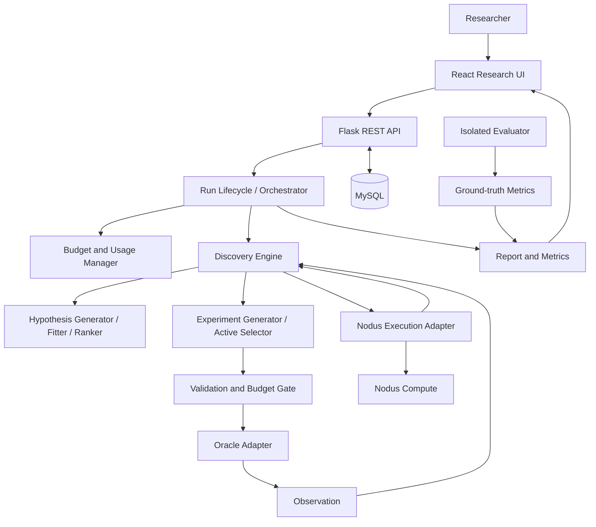

# CLARITY Architecture

## Status and goals

This is the intended MVP architecture, not a claim that components are already implemented. Preserve clear boundaries between discovery logic, UI, persistence, oracle access, and provider-specific execution. Keep hidden truth away from the discovery engine, enforce limits before scheduling work, and make the system testable without live services for every unit test.

## Logical architecture



The diagram is conceptual. Modules may be grouped differently, but the responsibilities and data-isolation guarantees must remain.

## Component responsibilities

### React research interface
- Configure runs and display status, progress, query counts, limits, and stop reason.
- Browse observations and hypotheses; show measured metrics, ranking rationale, evidence, and uncertainty only when supported.
- Submit researcher actions: add, pin/unpin, exclude/restore, and re-evaluate.
- Display reports and benchmark comparisons, including missing values and caveats.
- Provide loading, empty, unavailable, and error states.

The frontend is not authoritative for budgets or scientific scores. Server-side validation and enforcement are required.

### Flask API and services
- Validate requests and return consistent errors.
- Expose health, run, hypothesis, observation, report, and metric resources.
- Coordinate run lifecycle and researcher actions.
- Call domain services and persistence through stable interfaces.
- Keep scientific algorithms out of route handlers.
- Never expose hidden ground truth through ordinary API responses.

Initial endpoint sketch, not a frozen contract:
- `GET /api/health`
- `POST /api/runs`
- `GET /api/runs/{run_id}`
- `GET /api/runs/{run_id}/hypotheses`
- `POST /api/runs/{run_id}/hypotheses`
- `PATCH /api/runs/{run_id}/hypotheses/{hypothesis_id}`
- `GET /api/runs/{run_id}/observations`
- `GET /api/runs/{run_id}/report`
- `GET /api/runs/{run_id}/metrics`

Cancellation, benchmark retrieval, and individual researcher actions may need more endpoints. Agree on schemas/status codes before parallel implementation.

### Run lifecycle and orchestrator
Creates runs, initializes the engine, coordinates evaluation → selection → oracle query → observation persistence → update, checks budgets before work, tracks status/progress, and records terminal reason. States must distinguish successful completion, budget/limit stopping, cancellation, and failure. Preserve successful partial results when independent tasks fail. Use REST polling first; add streaming/workers only when needed and documented.

### Discovery engine
Keep domain logic independent of Flask request objects, React state, MySQL-specific models, and Nodus SDK internals. Subcomponents:
- **Hypothesis generator:** candidates in the supported family.
- **Fitter/evaluator:** fit candidates and calculate defined metrics from permitted observations.
- **Ranker/evidence tracker:** reproducible ranking and provenance.
- **Experiment generator:** valid candidate inputs.
- **Active selector:** disagreement and defensible uncertainty/information signals.
- **Stopping policy:** continue or stop with explicit reason.
- **Step interface:** execute a discovery step and return explicit outcomes.

Prioritize a narrow deterministic benchmark over a broad, unverifiable model library.

### Oracle adapter
Accepts a validated query and returns an observation. It must not expose rule parameters or evaluator labels to the discovery engine. Support deterministic local fixtures and keep the interface replaceable. Retries must be bounded and reflected in query accounting.

### Nodus execution adapter
Hides provider SDK details, submits independent tasks where supported, maps results/errors to task and candidate IDs, and handles timeouts, partial failures, bounded retries, and cancellation where available. It must not silently fall back to a local mock when remote mode was requested.

Mocked tests prove behavior against a mock only. Genuine remote-execution claims require a real task and redacted provider evidence. Verify SDK methods, native budget controls, cost reporting, and concurrency behavior before relying on them.

### Budget and usage services
Separate provider account balance from per-run limits. Run limits may include oracle queries, evaluation tasks, concurrency, wall-clock time, and a spend ceiling where supported. Enforce application-side limits before scheduling, including concurrent work. Track estimated, live/accruing, and settled/provider-confirmed costs separately. Unknown values remain unavailable.

### MySQL persistence
Persist runs/configuration, observations, hypotheses and revisions, evaluation results, experiment selections where useful, budget/usage records, audit events, and benchmark definitions/results. Use relationships and transactions appropriately. Preserve meaningful history. Table names, ORM, migration tooling, and indexes are implementation choices.

### Reporting and metrics
Build reports from persisted evidence. Show the top 3–5 candidates where available, representation, fit/held-out error, defined complexity, evidence, defensible uncertainty, usage, stop reason, and limitations. Missing metrics are unavailable, not zero. Record metric definitions and benchmark versions.

### Evaluator and benchmark runner
The evaluator is separate from discovery. It may access hidden rules/labels to calculate benchmark metrics, but these must not enter agent-facing inputs or ordinary discovery API responses. Compare active selection and random/passive selection under equivalent task/oracle family, candidate procedure, query budget, held-out evaluation, and documented seeds/repeated trials.

## End-to-end data flow

1. Researcher submits run configuration through React.
2. Flask validates it, persists the run, and returns an ID/status.
3. Orchestrator initializes the engine with permitted data only.
4. Engine generates candidate hypotheses.
5. Candidates are evaluated locally or through Nodus, according to the selected mode.
6. Results are associated with candidate IDs and persisted.
7. Ranker produces candidates with measured metrics and evidence.
8. Experiment generator proposes valid candidate queries.
9. Active selector scores queries using disagreement/uncertainty signals.
10. Budget manager checks whether more oracle and compute work is permitted.
11. Oracle adapter executes the selected query and returns an observation.
12. Observation and run event are persisted; candidate evaluations/evidence update.
13. Repeat until a stopping condition or resource limit is reached.
14. Record terminal status/reason and build the report from persisted evidence.
15. Frontend polls and displays hypotheses, observations, report, and metrics.
16. Separately, evaluator uses ground truth for benchmark scoring without exposing answers to discovery.

## Data isolation and failure rules

- Keep evaluator-only fields out of discovery objects and serializers.
- Never put secret rules in shared configuration, logs, debug messages, frontend bundles, or reports.
- Use explicit API serialization allowlists.
- Test that ground truth cannot leak into agent-facing objects or responses.
- A failed task is not a zero-valued metric; unknown results remain unavailable.
- Preserve completed observations/evaluations after budget exhaustion.
- Record real vs mocked remote execution accurately.
- Bound retries and prevent duplicate events from creating duplicate records where idempotency is required.

## Suggested code boundaries

```text
backend/
  app/
    api/             # Flask routes and request/response schemas
    services/        # orchestration, budgets, reports, benchmarks
    domain/          # hypotheses, observations, experiments, policies
    adapters/
      oracle/        # black-box query adapters
      nodus/         # remote execution adapter
      persistence/   # MySQL/repository implementations
    config.py
  tests/
    unit/
    integration/
```

This is a suggestion, not a mandatory layout before the application skeleton exists.

## Verification strategy

- **Unit:** contracts, validation, fitting/ranking, experiment scoring, stopping, budget gates, serializers, state transitions.
- **Deterministic integration:** local oracle fixture and fake execution adapter.
- **Database:** persistence, transactions, migrations, revision history.
- **Nodus adapter:** mocked success, partial failure, timeout, malformed payload.
- **Real Nodus smoke test:** separately recorded when access is available.
- **Frontend:** run setup, polling, researcher actions, error states, reports/benchmarks.
- **Scientific:** active vs random under matched budgets.
- **End-to-end:** clean startup, discovery flow, persisted evidence, budget behavior, report, measured benchmark, limitations.

See [decisions.md](decisions.md) for unresolved architecture choices.
