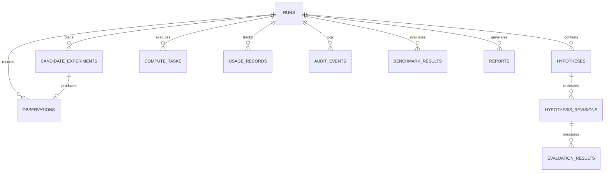

# CLARITY Persistence Layer and Schema Specification

**Document Version:** 1.0.0 (Issue #18 Baseline)  
**Status:** Confirmed  
**Implementation References:**
- Engine & Session Management: [backend/app/adapters/persistence/database.py](../backend/app/adapters/persistence/database.py)
- Relational Models: [backend/app/adapters/persistence/models.py](../backend/app/adapters/persistence/models.py)
- Repository: [backend/app/adapters/persistence/repository.py](../backend/app/adapters/persistence/repository.py)
- Seed Factory: [backend/app/adapters/persistence/seed.py](../backend/app/adapters/persistence/seed.py)
- Migrations: `backend/migrations/` (Alembic)

---

## 1. Relational Entity Architecture



### Table Specifications:

1. **`runs`:**
   * Primary Key: `run_id` (String(64))
   * Attributes: `name`, `domain`, `status`, `execution_mode`, `sampling_strategy`, `stop_reason`
   * Limits: `max_queries`, `max_evaluations`, `max_runtime_seconds`, `spend_ceiling_usd`
   * Timestamps: `created_at`, `started_at`, `completed_at`
   * Indexes: `idx_runs_status`, `idx_runs_created_at`

2. **`hypotheses`:**
   * Primary Key: `hypothesis_id` (String(64))
   * Foreign Key: `run_id` references `runs(run_id)`
   * Attributes: `model_family`, `current_revision`, `is_pinned`, `is_excluded`
   * Indexes: `idx_hypotheses_run_state` (`run_id`, `is_excluded`, `is_pinned`)

3. **`hypothesis_revisions`:**
   * Primary Key: `revision_id` (String(64))
   * Foreign Key: `hypothesis_id` references `hypotheses(hypothesis_id)`
   * Unique Constraint: (`hypothesis_id`, `revision_number`)
   * Attributes: `revision_number`, `formula` (Text), `parameters` (JSON), `complexity`, `creation_source` (`generator`, `refit`, `researcher`)

4. **`observations`:**
   * Primary Key: `observation_id` (String(64))
   * Foreign Key: `run_id` references `runs(run_id)`
   * Attributes: `input_id`, `input_values` (JSON), `output_values` (JSON), `status`, `sequence_number`, `is_held_out`, `error_code`, `error_message`, `noise_metadata` (JSON)
   * Indexes: `idx_observations_run_seq`, `idx_observations_run_heldout`

5. **`candidate_experiments`:**
   * Primary Key: `experiment_id` (String(64))
   * Foreign Keys: `run_id`, `observation_id` (references `observations(observation_id)`)
   * Attributes: `proposed_input` (JSON), `selection_rationale` (JSON), `execution_status`

6. **`evaluation_results`:**
   * Primary Key: `evaluation_id` (String(64))
   * Foreign Keys: `revision_id` references `hypothesis_revisions(revision_id)`, `run_id`
   * Attributes: `status`, `sample_count`, `dataset_version`, `metrics` (JSON), `held_out_metrics` (JSON), `evaluated_at`
   * Invariant: Points explicitly to an immutable hypothesis revision and the observation dataset version available at evaluation time.

7. **`compute_tasks`:**
   * Primary Key: `task_id` (String(64))
   * Foreign Key: `run_id`
   * Attributes: `candidate_id`, `execution_mode`, `provider_task_id`, `status`, `duration_ms`, `error_metadata` (JSON)

8. **`usage_records`:**
   * Primary Key: `usage_id` (String(64))
   * Foreign Key: `run_id`
   * Attributes: `queries_executed`, `evaluations_scheduled`, `evaluations_completed`, `estimated_cost_usd`, `live_accruing_cost_usd`, `settled_cost_usd`, `is_budget_exhausted`, `exhaustion_reason`

9. **`audit_events`:**
   * Primary Key: `event_id` (String(64))
   * Foreign Key: `run_id`
   * Attributes: `event_type`, `actor`, `metadata_json` (JSON), `timestamp`

10. **`benchmark_results`:**
    * Primary Key: `benchmark_id` (String(64))
    * Foreign Key: `run_id`
    * Attributes: `benchmark_name`, `target_label`, `hit_at_1`, `hit_at_3`, `hit_at_5`, `reciprocal_rank`, `best_candidate_id`, `queries_to_target`, `held_out_mae`, `held_out_rmse`, `baseline_type`, `efficiency_gain`

11. **`reports`:**
    * Primary Key: `report_id` (String(64))
    * Foreign Key: `run_id`
    * Attributes: `status`, `ranked_candidates` (JSON), `stop_reason`, `limitations`, `artifact_uri`

---

## 2. Integrity and Scientific History Preservation

- **Immutable Revisions:** Every modification or parameter refit of a hypothesis creates a new revision record (`revision_number = n + 1`). Prior revisions are never overwritten or deleted.
- **Non-Destructive Parent Retention:** Relationships between runs, hypotheses, revisions, observations, and audit events configure `passive_deletes=True` with database-level `RESTRICT` foreign key rules. Cascading deletions are disabled to prevent accidental erasure of scientific history or audit trails.
- **Cross-Run Evaluation Isolation:** Evaluations strictly require that the target hypothesis revision belongs to the exact same discovery run (`run_id`). Cross-run evaluations are rejected to preserve strict provenance.
- **Evaluation Provenance:** Evaluation results point directly to `revision_id` and record `dataset_version` (observation count). This ensures that historical evaluations are reproducible across discovery steps.
- **Researcher Action Non-Destructiveness:** Pinning (`is_pinned`) and excluding (`is_excluded`) update hypothesis state flags while logging immutable audit events. Raw evaluation scores and historical records are never modified by UI preferences.

---

## 3. Database Configuration and Migrations

### Configuration via Environment Variables:
- **`DATABASE_URL`:**
  - Production: Required valid database URL (e.g. `mysql+pymysql://<user>:<password>@<host>:3306/<dbname>`). Silent fallback to SQLite is strictly forbidden in production.
  - Local Development Fallback: `sqlite:///clarity_dev.db`
  - Automated Unit Tests: `sqlite:///:memory:` (with SQLite foreign key enforcement enabled via `PRAGMA foreign_keys=ON`)

### Migration Commands (Alembic):
```bash
# Run pending migrations to head
alembic upgrade head

# Revert last migration
alembic downgrade -1

# Generate new migration after editing models
alembic revision --autogenerate -m "description_of_change"
```
