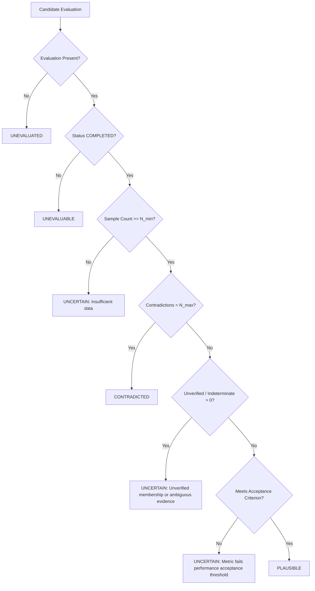

# Hypothesis Ranking and Evidence Tracking

This document specifies the scientific principles, mathematical definitions, data contracts, and execution rules for hypothesis ranking and empirical evidence tracking in CLARITY (Issue #7).

---

## 1. Scientific Philosophy and Anti-Patterns Avoided

CLARITY maintains competing structured hypotheses and evaluates how well each candidate explains observed system behavior under limited query budgets.

### Core Scientific Invariants

1. **Decoupling Predictive Ranking from Evidence Counting**:
   - Observations evaluated by candidates are synthesized into standardized predictive metrics ($MAE$, $RMSE$).
   - Sorting candidates primarily by "supporting observation count" or awarding arbitrary additive score bonuses for evidence creates a **double-counting anti-pattern** and introduces sample-size bias (penalizing candidates evaluated on smaller, high-fidelity datasets).
   - In CLARITY, ranking primarily reflects valid, comparable evaluation metrics and model complexity. Empirical evidence serves to:
     - Explain *why* a candidate ranks where it does.
     - Establish its scientific plausibility status (`PLAUSIBLE`, `CONTRADICTED`, `UNCERTAIN`).
     - Track individual observations that confirm or challenge the model.

2. **Strict Metric Comparability & Presentation Tiers**:
   - Held-out evaluation measures generalization to unseen inputs; training evaluation measures fitting fidelity.
   - Held-out and training metrics are **never** treated as equivalent or compared cross-partition.
   - Candidates evaluated on incompatible datasets, differing metric definitions, or non-finite values are assigned to distinct **presentation tiers**, not fabricated numerical penalties.

3. **Decoupled Empirical Evidence Identity vs. Provenance**:
   - The empirical comparison—"Candidate $H$ predicted $\hat{y}$ for input $x$ of Observation $O$ with residual $r$"—has the deterministic identity `(hypothesis_id, observation_id, partition)`.
   - Repeatedly evaluating the same observation under new model revisions updates evaluation metadata (`evaluation_id`, `dataset_version`, `timestamp`) idempotently without duplicating observation counts.

4. **Calibrated Status without Fabricated Claims**:
   - Never outputs arbitrary percentage confidence scores (e.g. "94% confident") or claims that the top-ranked candidate is the "true hidden rule".
   - Transparently articulates evidence limitations, sample count constraints, and residual thresholds.

---

## 2. Evidence Tracking System

### Mathematical Tolerance Definition

For each observation with observed scalar output $y_{\text{obs}}$ and candidate prediction $\hat{y}$, the residual is computed as:
$$r = |y_{\text{obs}} - \hat{y}|$$

The dynamic tolerance threshold $T$ is determined by the configured policy ($\tau_{\text{abs}}, \tau_{\text{rel}}$):
$$T = \tau_{\text{abs}} + \tau_{\text{rel}} \cdot |y_{\text{obs}}|$$

Classification rules:
- **`SUPPORTING`**: $r \le T$ (both values finite).
- **`CONTRADICTING`**: $r > T$ (both values finite).
- **`INDETERMINATE`**: Prediction failed, observation status was non-success, or either value overflowed/non-finite.

### Evidence Contracts

- **`EvidenceRecord`**:
  - `evidence_id`: Deterministic string `f"evi-{hypothesis_id}-{observation_id}-{partition}"`.
  - `hypothesis_id`: Candidate identifier.
  - `observation_id`: Source observation identifier.
  - `experiment_id`: Associated input experiment ID.
  - `partition`: `"training"` or `"held_out"`.
  - `classification`: `EvidenceClassification` (`SUPPORTING`, `CONTRADICTING`, `INDETERMINATE`).
  - `observed_value`, `predicted_value`, `residual`, `tolerance`: Floats or `None`.
  - `dataset_id`, `evaluation_id`, `dataset_version`, `timestamp`: Provenance metadata.

- **`EvidenceSummary`**:
  - Aggregates unique observation counts: `supporting_count`, `contradicting_count`, `indeterminate_count`, `total_evaluated`.
  - Preserves ordered tuples: `supporting_observation_ids`, `contradicting_observation_ids`, `indeterminate_observation_ids`.

- **`EvidenceStore`**:
  - In-memory/repository storage ensuring idempotent ingestion and revision updating.

---

## 3. Plausibility Status Derivation

The scientific status (`PlausibilityStatus`) of a candidate is derived deterministically from its evaluation result and evidence summary:



- **`UNEVALUATED`**: No evaluation has been performed.
- **`UNEVALUABLE`**: Fitter or evaluator failed (e.g. unregistered family, rank deficiency).
- **`UNCERTAIN`**: Fewer than `min_samples_for_plausibility` (default: 5) samples, unverified observation membership, non-finite indeterminate comparisons, or primary metric failing configured `performance_acceptance_threshold`. When `performance_acceptance_threshold` is unconfigured (`None`), the absence of an agreed acceptance criterion ensures the status remains `UNCERTAIN` rather than asserting plausibility without an empirical basis.
- **`CONTRADICTED`**: Contradictions exceed `max_tolerated_contradictions` (default: 0).
- **`PLAUSIBLE`**: Sufficient sample count, zero intolerable contradictions, verified observation membership, no indeterminate residuals, and validated predictive metric performance meeting the explicit `performance_acceptance_threshold`.

---

## 4. Hypothesis Ranking Engine

### Comparability Cohorts & Presentation Tiers

Candidates evaluated across incompatible datasets, metric versions, or metric definitions are grouped into distinct **comparability cohorts** keyed by:
$$(EvaluationTier, \text{dataset\_id}, \text{metric\_version}, \text{metric\_definition})$$

Candidates are strictly ranked by predictive metric magnitude **only within their own comparability cohort**.

Missing required comparability metadata (`dataset_id`, `metric_version`, or the primary metric key in `metric_definitions`) classifies candidates as `INCOMPARABLE` (Priority 2) with `within_cohort_rank = None` by default. Direct metric comparison of unverified candidates requires an explicit policy override (`allow_unverified_comparability = True`), which assigns them to unverified cohorts with audit limitations.

Candidates are ordered across distinct presentation tiers to prevent invalid comparisons:

1. **`VALID_HELD_OUT`** (Priority 0): Candidates with completed evaluation and finite primary metric on held-out data with verified dataset identity and verified metric definitions/versions.
2. **`VALID_TRAINING_ONLY`** (Priority 1): Candidates with completed evaluation on training data only (generalization unverified) with verified dataset identity and verified metric definitions/versions.
3. **`INCOMPARABLE`** (Priority 2): Completed evaluations with non-finite primary metrics, missing dataset identifiers, missing metric version/definition metadata (unless `allow_unverified_comparability=True`), or unverified comparability.
4. **`EVALUATION_FAILED`** (Priority 3): Evaluations that aborted with structured errors.
5. **`UNEVALUATED`** (Priority 4): Candidates awaiting evaluation.

### Display Position vs. Scientific Rank

To prevent misleading cross-cohort comparisons:
- **`within_cohort_rank`**: The scientifically meaningful rank (1-based integer) within the candidate's comparability cohort. `None` for non-rankable tiers (`INCOMPARABLE`, `EVALUATION_FAILED`, `UNEVALUATED`).
- **`rank`**: The global presentation order / display position across all cohorts.
- Cross-cohort display order is annotated with `comparability_notes` and limitations.

### Within-Cohort Complexity Window & Sorting

Within a comparable cohort (`VALID_HELD_OUT` or `VALID_TRAINING_ONLY`):

1. **Anchor Group Best Metric**: Identify $s_{\text{best}}$ (e.g. minimum $MAE$).
2. **Equivalence Banding**:
   $$\text{band} = \left\lfloor \frac{|s - s_{\text{best}}|}{\max(|s_{\text{best}}|, 1e-9) \cdot \epsilon_{\text{comp}}} \right\rfloor$$
   Candidates within $\epsilon_{\text{comp}}$ (default: 1% relative threshold) share $\text{band} = 0$.
3. **Total Sort Key**:
   $$(\text{cohort\_priority}, \text{band}, \text{complexity}, \text{primary\_metric}, \text{secondary\_metric}, \text{hypothesis\_id})$$
   - **Simplicity Preference**: When candidates are in the same relative performance band, the simpler model (lower complexity) ranks ahead.
   - **Performance Distinction**: When candidates differ materially ($> \epsilon_{\text{comp}}$), the candidate with the lower error ranks ahead regardless of complexity.
   - **Deterministic Tie-Breaking**: Remaining exact ties are broken deterministically using lexicographical `hypothesis_id`.

---

## 5. Usage Example

```python
from app.domain import (
    HypothesisRanker,
    RankingPolicyConfig,
    rank_candidates,
)

# 1. Define ranking policy
policy = RankingPolicyConfig(
    primary_metric="mae",
    secondary_metric="rmse",
    metric_direction="minimize",
    complexity_window=0.01,           # 1% relative window for complexity preference
    tolerance_absolute=0.05,          # tau_abs
    tolerance_relative=0.01,          # tau_rel
    min_samples_for_plausibility=5,
    max_tolerated_contradictions=0,
)

# 2. Instantiate ranker service
ranker = HypothesisRanker(policy)

# 3. Rank candidates
ranking_result = ranker.rank_candidates(
    candidates=candidate_hypotheses,
    evaluation_results=evaluation_results_map,
    observations_by_hypothesis=observations_map,
)

for ranked in ranking_result.ranked_candidates:
    print(f"Rank {ranked.rank}: {ranked.hypothesis_id}")
    print(f"  Tier: {ranked.evaluation_tier.value}")
    print(f"  Status: {ranked.status.value}")
    print(f"  Score: held-out {ranked.held_out_score} | training {ranked.training_score}")
    print(f"  Complexity: {ranked.complexity}")
    print(f"  Explanation: {ranked.explanation}")
    if ranked.limitations:
        print(f"  Limitations: {ranked.limitations}")
```
